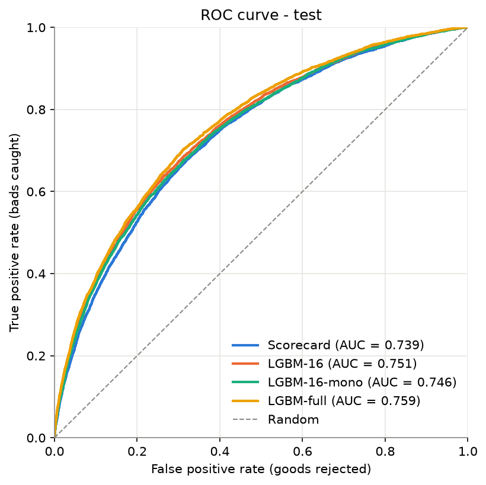
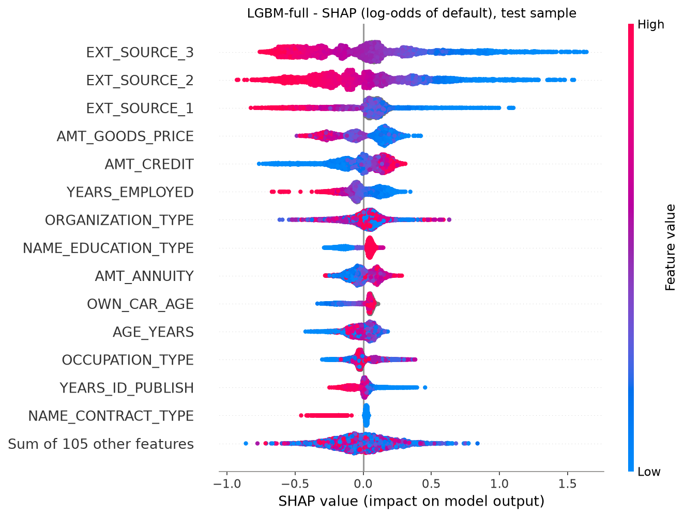
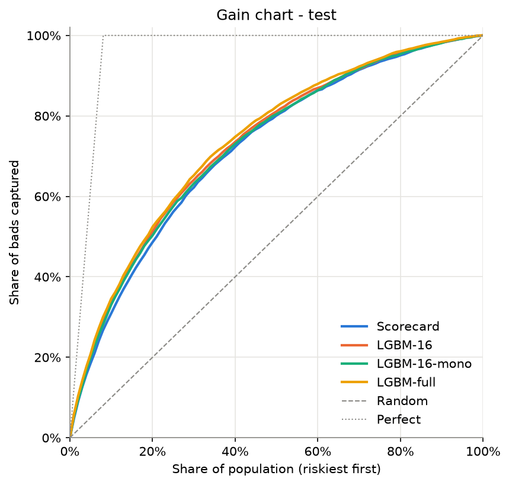
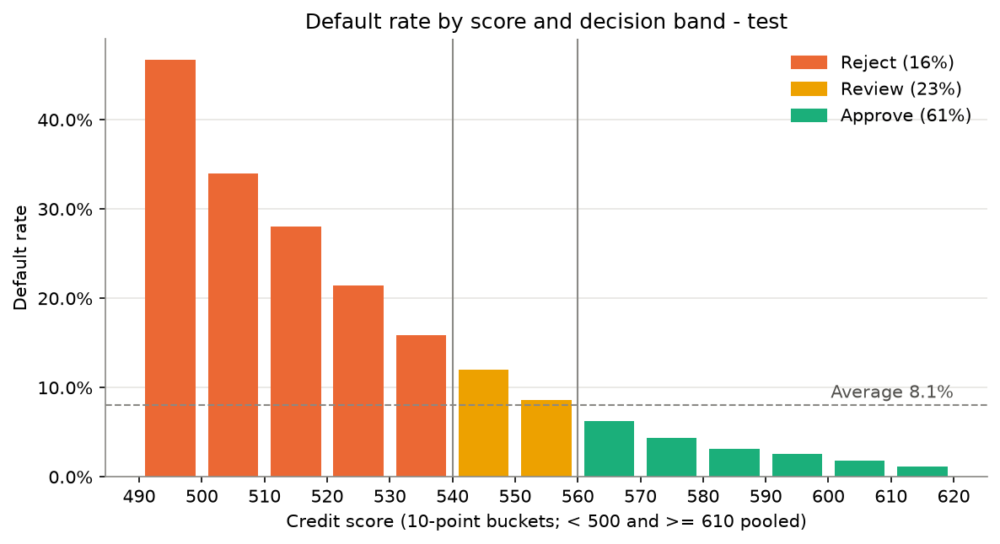
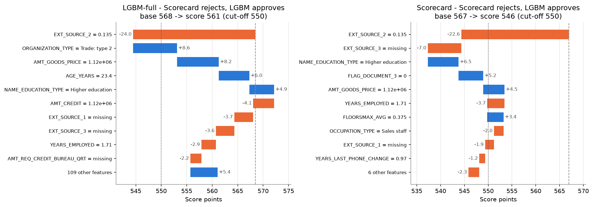
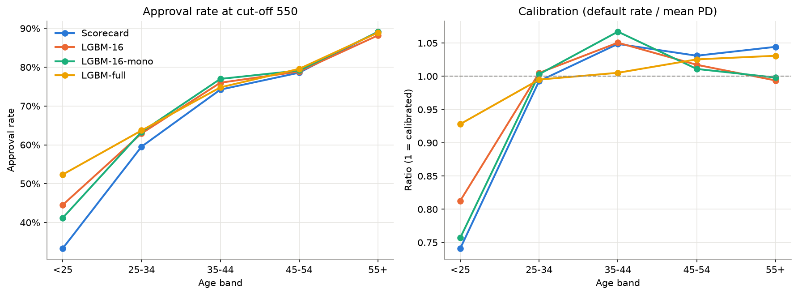

# Credit Risk Scorecard with Explainable AI

An end-to-end credit scorecard built on the [Home Credit Default Risk](https://www.kaggle.com/competitions/home-credit-default-risk) dataset, following the classic banking workflow: **WoE binning → IV-based feature selection → logistic regression → points-based scorecard**. It is then challenged by **LightGBM**, explained with **SHAP**, audited for **fairness**, validated with confidence intervals, and packaged as a **three-way decision policy** with a **command-line scoring tool**.

See [MODEL_CARD.md](MODEL_CARD.md) for intended use, limitations and deployment considerations.

## Key results

| Model (test set, 61,503 applications) | AUC | Gini (95% CI) | KS | PR-AUC | Features |
|---|---|---|---|---|---|
| **Scorecard** (logistic regression on WoE) | 0.739 | 0.477 (0.464–0.490) | 0.357 | 0.216 | 16 |
| LGBM-16 (same features, raw values) | 0.751 | 0.502 (0.488–0.515) | 0.373 | 0.239 | 16 |
| LGBM-16-mono (+ monotone constraints) | 0.746 | 0.491 (0.477–0.505) | 0.363 | 0.230 | 16 |
| LGBM-full | **0.759** | **0.518** (0.505–0.531) | **0.391** | **0.250** | 119 |

PR-AUC of a random model equals the default rate (0.081), so the scorecard is 2.7× better than random on the bad class.

- **The scorecard is solid and fully transparent.** 16 features, all coefficients negative, points fall with bad rate within every feature, and the calibration ratio is 0.91–1.08 in every decile. Score scale: 600 points at 50:1 odds, PDO 20. Score PSI and every feature's CSI between train and test are below 0.001.
- **LightGBM adds +0.041 Gini, and the gain is real but small.** A paired bootstrap (500 resamples) gives a 95% CI of +0.035 to +0.048, so it excludes 0. About 60% of the gain comes from the algorithm and 40% from extra features. Monotone constraints cost 0.010 Gini and remove counter-intuitive local behaviour: without them, only 0–40% of individual PD curves are monotone for most features. The gain curves nearly overlap; LightGBM's edge sits mainly in the riskiest decile (lift 3.5 vs 3.1).
- **SHAP shows that both models agree on the essentials.** The top 3 drivers are the same in both (`EXT_SOURCE_3/2/1`), the 16 scorecard features carry 66% of LightGBM's importance, and the two models make the same decision for 89% of applicants at cut-off 550. LightGBM's extra signal comes mostly from loan structure: `AMT_CREDIT` vs `AMT_GOODS_PRICE` act in opposite directions, which amounts to a credit-to-price ratio.
- **A Review band cuts automatically approved bads by a third.** Reject below 540, review 540–559 by hand, approve from 560 (PD ≤ 7.4%, below the 8.07% average). Compared with a single cut-off at 550, the share of all bads that are approved automatically falls from 42% to 28%, and the approved default rate falls from 4.6% to 3.8%. The cost is that 23% of applications go to manual review.
- **Fairness through unawareness is not enough.** Gender is excluded, yet the features predict it with AUC 0.88 (via `OCCUPATION_TYPE`, `OWN_CAR_AGE`, `ORGANIZATION_TYPE`). Every model over-estimates women's risk (calibration 0.93–0.95) and under-estimates men's (1.08–1.12). In score terms this is small: women score about 2 points too low and men about 4 points too high. The scorecard, which does not use age, **over-estimates the risk of applicants under 25 by about 35%**. That is about 10 points too low: their true default rate (11.7%) corresponds to a Review-band score, yet 49% of them are rejected outright. LGBM-full, which uses age, is better calibrated for them (0.93).

<p align="center">
  
  
</p>

<p align="center">
  
  
</p>

**Same applicant, two explanations.** The scorecard rejects (546 < 550) and LightGBM approves (561). Both are expressed in score points (blue = raises the score, orange = lowers it):



**Approval rate and calibration by age band** (cut-off 550):



## Score an applicant

The champion scorecard is packaged in `src/pipeline.py` and exposed through a command-line tool. Run it from the project root; the commands are the same in bash and fish.

```bash
python -m src.cli --id 100002              # applicant from data/test.pkl or data/train.pkl (needs data/)
python -m src.cli --template > khach.json  # example applicant to edit
python -m src.cli --json khach.json        # new applicant (works without data/)
python -m src.cli --help
```

```
Applicant 100002 (train set)
----------------------------------------
Score     496   (average applicant 567)
PD        42.2%
Decision  REJECT

Main reasons lowering the score (vs average applicant):
  1. EXT_SOURCE_3 = 0.1394    -28.8 pts
  2. EXT_SOURCE_1 = 0.08304   -14.1 pts
  3. EXT_SOURCE_2 = 0.2629    -12.3 pts
  4. YEARS_EMPLOYED = 1.74     -3.7 pts

Main reasons raising the score:
  1. YEARS_LAST_PHONE_CHANGE = 3.1    +0.6 pts
  2. REG_CITY_NOT_LIVE_CITY = 0       +0.3 pts

Actual outcome: default
Waterfall saved: outputs/cli/applicant_100002.png
```

The JSON holds one applicant in the **cleaned format**: ages and durations in years, and categories as labels. Absent keys or `null` are scored as missing, and unknown categories as `Rare`. The tool reports missing and unrecognised keys. A waterfall chart of the score, from the average applicant to this one with the decision bands shaded, is saved to `outputs/cli/`.

In Python:

```python
from pathlib import Path
from src.pipeline import load_bundle, score_applicant, score_frame

bundle = load_bundle(Path("outputs"))
result = score_applicant({"EXT_SOURCE_3": 0.4, "EXT_SOURCE_2": 0.55}, bundle)
result.score, result.pd, result.decision, result.adverse   # one applicant
score_frame(applicants_df, bundle)                          # many applicants at once
```

## Data

Download `application_train.csv` from the [Kaggle competition page](https://www.kaggle.com/competitions/home-credit-default-risk/data) and place it in `data/`:

```
data/application_train.csv   # 307,511 applications × 122 columns
```

`data/` is git-ignored; all intermediate files are regenerated by the notebooks. Scoring JSON applicants with the CLI only needs the tracked artifacts in `outputs/`.

## Setup

```bash
conda create -n credit-risk python=3.12 -y
conda activate credit-risk
pip install -r requirements.txt
python -m ipykernel install --user --name credit-risk --display-name "Python (credit-risk)"
```

Open the notebooks with the **Python (credit-risk)** kernel.

## Pipeline

Run the notebooks in order; each one reads the files written by the previous one.

| Notebook | Step | Main outputs |
|---|---|---|
| `01_eda` | Structure, default rate, missing values, variable types | — |
| `02_data_cleaning` | Fix `DAYS_EMPLOYED` placeholder, invalid labels, days → years | `data/application_train_clean.pkl` |
| `03_train_test_split` | Stratified 80/20 split | `data/train.pkl`, `data/test.pkl` |
| `04_woe_iv` | Fine classing, WoE and IV (train only) | `outputs/woe_spec.pkl`, `outputs/iv_summary.csv` |
| `05_feature_selection` | Monotonic coarse classing, IV and correlation filters, WoE encoding | `data/woe_*.pkl`, `outputs/selected_features.csv` |
| `06_modelling` | Logistic regression, stepwise drop on sign / p-value / VIF | `outputs/logit_model.pkl`, `model_coefficients.csv` |
| `07_evaluation` | AUC, Gini, KS, ROC/KS curves, gains table (test) | `outputs/metrics.csv`, `gains_table_test.csv` |
| `08_scorecard` | PDO scaling, points table, direction checks, calibration, PSI, cut-offs | `outputs/scorecard.csv`, `cutoff_table_test.csv` |
| `09_lightgbm` | LightGBM challengers (with / without monotone constraints) | `outputs/lgbm_*.pkl`, `model_comparison.csv` |
| `10_shap` | SHAP: global importance, dependence, case studies, reason codes | `outputs/shap_importance.csv`, `reason_codes_cases.csv` |
| `11_fairness` | Approval, calibration and AUC by gender and age; proxy check | `outputs/fairness_*.csv` |
| `12_validation` | PR-AUC, bootstrap Gini CIs, gain / lift / calibration charts, CSI | `outputs/validation_summary.csv`, `csi.csv` |
| `13_cutoff_strategy` | Reject / Review / Approve bands, scheme comparison, bands by group | `outputs/decision_bands.csv`, `decision_by_group.csv` |

## Methodology

**Binning and selection**
- **Missing values are not imputed** for binned features. They form their own `Missing` bin, so missingness can carry signal. Columns are dropped by IV, not by missing rate.
- **WoE = ln(%good / %bad)**: positive values mean lower risk than average. Bins holding < 0.5% of rows get WoE 0, because smoothing would otherwise give tiny bins unreliable or even wrong-sign WoE.
- **Fine classing**: up to 10 quantile bins per numeric feature; categories with < 1% of rows are grouped into `Rare`.
- **Coarse classing**: adjacent numeric bins are merged until the bad rate is strictly monotonic.
- **Selection**: IV ≥ 0.02, then greedy removal of features with |r| ≥ 0.7 (on WoE values) against a higher-IV feature.

**Scorecard**
- **Protected attributes** (`CODE_GENDER`, `NAME_FAMILY_STATUS`) are excluded from all models.
- **Stepwise cleanup**: the model is refit after each drop. The feature dropped first is the one with a positive coefficient, then any with p > 0.05, then any with VIF > 5. This removed `AGE_YEARS`, `REGION_POPULATION_RELATIVE`, `REG_CITY_NOT_WORK_CITY` and `NAME_INCOME_TYPE`, all for sign flips. All VIFs are below 2.
- **Scaling**: `score = offset + factor × ln(odds)`, with `factor = PDO / ln 2`. The intercept is spread evenly over the features, so a score is the sum of bin points.

**LightGBM and SHAP**
- Same train/test split. Early stopping uses a validation split carved from train, and the final model is refit on the full train set. The test set is never used for tuning. No class weights are used, so PDs stay calibrated.
- Monotone directions come from the Spearman correlation of each feature with the target on train; categorical features are left unconstrained.
- SHAP values are exact TreeSHAP (LightGBM `pred_contrib`), converted to score points as `−factor × SHAP`. For the scorecard, the equivalent is each feature's points minus its train average.

**Validation and decision policy**
- **Paired bootstrap**: every model is scored on the same resample, so the CI of the Gini *difference* between models is valid.
- **CSI**: PSI computed on each feature's WoE bins, train vs test.
- **Decision bands**: the thresholds are read in PD terms. 560 corresponds to PD 7.4% (below average) and 540 to PD 13.8%. Five schemes were compared on volume per band, default rate per band, and the share of bads approved automatically. The comparison uses **train only**, with out-of-fold PDs from a 5-fold CV of the logit; test is used once, to report the chosen scheme.

All binning, WoE values, category levels and constraints are fitted on train and applied unchanged to test.

## Limitations

- **Single random split.** The test set has now been used for evaluation, so further model changes should be compared with cross-validation on train. There is no out-of-time validation; the near-zero PSI/CSI reflects the random split, not real stability over time.
- **Only the `application` table is used.** Bureau and previous-application data would add signal; leaderboard models reach AUC ≈ 0.80.
- **No reject inference.** The data only contains approved loans, so the model has never seen how rejected applicants would have performed.
- **The fairness analysis is descriptive.** The under-25 group is small (2,390 test applicants, 280 defaults). No mitigation has been applied, and whether age may be used depends on the jurisdiction. A policy rule (route under-25s scoring 530–559 to Review) is suggested but not implemented.
- **The CLI is a demonstrator, not a service.** It expects cleaned inputs and does no range validation; see the deployment notes in the [model card](MODEL_CARD.md).

## Project structure

```
src/            Pure, typed, tested functions
  eda.py          Structure, target distribution, missing values, variable types
  cleaning.py     Minimal cleaning pipeline
  split.py        Stratified train/test split
  woe.py          Binning, WoE/IV, monotonic coarse classing, WoE encoding
  selection.py    IV and correlation filters
  model.py        Logistic regression, VIF, stepwise drop, PD prediction, out-of-fold PD (CV)
  evaluation.py   AUC/Gini/KS, PR-AUC, bootstrap CIs, gains/lift, calibration, PSI/CSI
  scorecard.py    PDO scaling, points table, direction checks, cut-offs, decision bands
  gbm.py          LightGBM features, monotone constraints, training
  explain.py      SHAP in score points, reason codes, case selection
  fairness.py     Group metrics, disparate impact, proxy check
  pipeline.py     Score and explain new applicants with the champion scorecard
  cli.py          Command-line scoring tool
notebooks/      Pipeline steps 01–13
tests/          pytest suite (101 tests)
outputs/        Specs, tables and figures produced by the notebooks (cli/ is git-ignored)
data/           Raw and intermediate data (git-ignored)
```

## Tests

```bash
pytest -v
```

One integration test re-scores the whole test set through the pipeline. It is skipped when `data/` is absent.

## Roadmap

- [x] EDA and cleaning
- [x] WoE/IV binning and feature selection
- [x] Logistic regression (coefficient signs, p-values, VIF)
- [x] Evaluation: AUC, Gini, KS
- [x] Score scaling (PDO) and scorecard table
- [x] LightGBM challengers with monotone constraints
- [x] Explainability with SHAP
- [x] Fairness check by gender and age
- [x] Final validation: PR-AUC, bootstrap CIs, gain / lift charts, CSI
- [x] Decision policy: Reject / Review / Approve bands
- [x] Scoring pipeline and command-line tool
- [ ] Ratio features (credit / goods price, annuity / income) for a scorecard v2, validated with CV
